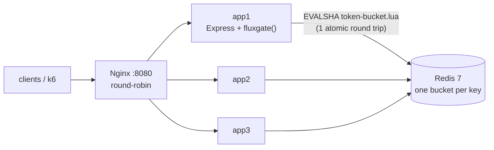
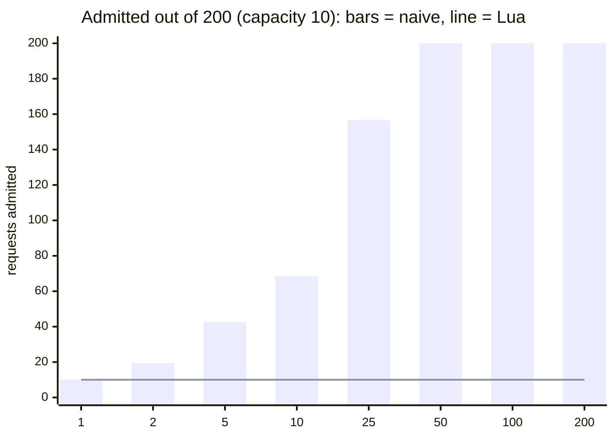
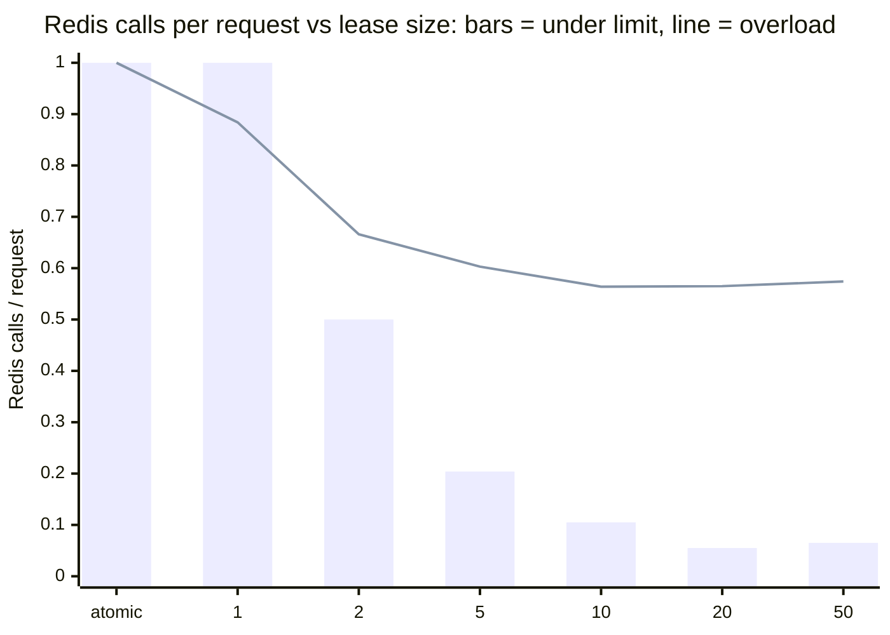
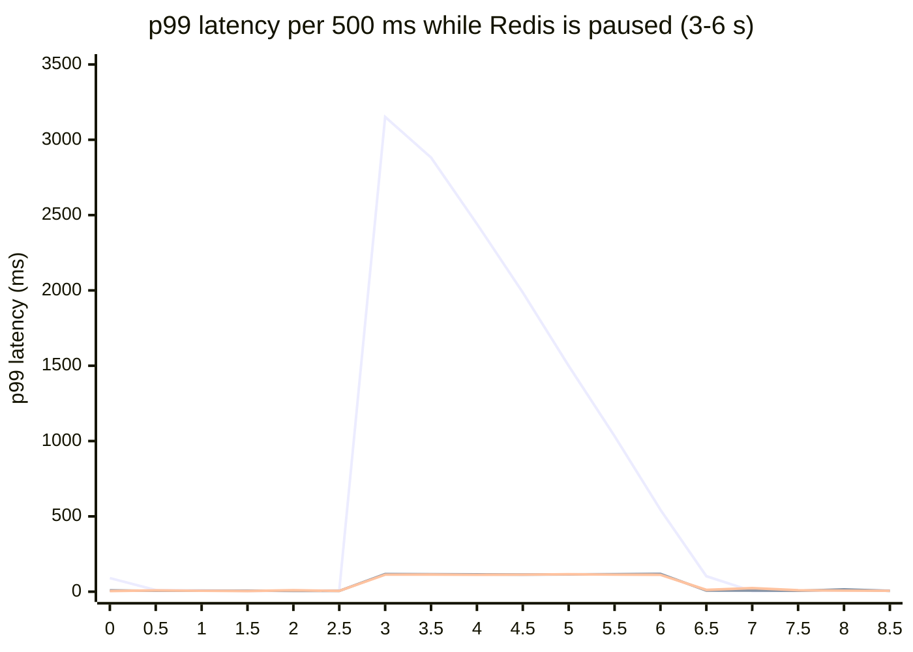

# FluxGate

**A distributed rate limiter built from first principles: five algorithms, an atomic Redis store, an Express middleware and a measured evaluation of where each design breaks.**

No rate-limiting libraries. The only runtime dependencies are `express` (HTTP) and `ioredis` (a Redis client). Every algorithm, the Lua script, the middleware and the benchmarks are written from scratch in TypeScript.

[](.github/workflows/ci.yml)    

The project follows one loop: **build it, break it, measure it, fix it.**

| | Finding | Evidence |
|---|---|---|
| 🔴 | An in-memory limiter behind 3 load-balanced instances allows **2.9× the limit**. | [k6, end to end](#4-end-to-end-3-instances-behind-nginx) |
| 🔴 | A shared Redis limiter written as GET → compute → SET allows up to **20× the limit** under concurrency. `MULTI` doesn't fix it. | [race experiment](#1-the-race-condition-and-its-fix) |
| 🟢 | Moving read-decide-write into one Lua script admits **exactly the limit** in every trial, from 1 to 200 concurrent clients. It also uses one round trip instead of two. | same |
| 🟢 | With a stock Redis client, a frozen Redis makes every request **hang for up to 3.1 s**. Fail-fast settings plus a 100 ms limiter timeout bring the p99 to **116 ms**, and you choose whether to allow (fail-open) or reject (fail-closed). | [failover experiment](#5-what-happens-when-redis-freezes) |
| 🧪 | Token leasing (borrowing tokens from Redis in batches) cuts Redis calls by **18×** below the limit (0.055 per request) with no measurable over-admission, at the cost of rare false denials. | [leasing experiment](#3-token-leasing-fewer-redis-calls-for-a-little-precision) |

---

## Architecture



The app instances are **stateless**. All limiter state lives in Redis, so a client's limit is global no matter which instance Nginx routes it to. Redis runs each Lua script to completion before anything else, which makes "read the bucket, refill, decide, write back" a single indivisible step. The script reads time from Redis's own clock (`TIME`), so clock skew between app servers can't create tokens.

| Package | What it is |
|---|---|
| [`@fluxgate/core`](packages/core) | Five algorithms as pure, synchronous, zero-dependency classes with an injectable clock: **fixed window, sliding window log, sliding window counter, token bucket, GCRA.** Publishable to npm. |
| [`@fluxgate/redis`](packages/redis) | Distributed stores: the **naive** (racy) bucket kept on purpose as the "before", the **atomic Lua** bucket, and the **leased** bucket. Includes a Redis client tuned to fail fast. |
| [`@fluxgate/server`](packages/server) | `fluxgate()` Express middleware with standard `X-RateLimit-*` / `Retry-After` headers, **per-key tiers**, **fail-open / fail-closed** and a limiter timeout, plus a demo API. |
| [`bench`](packages/bench) | Five reproducible experiments that write `results/*.json`. `npm run report` renders them into the tables below. |

## Quick start

Requirements: Node.js 20+ and Docker.

```bash
npm install
npm test                      # 38 tests; Redis integration tests run when Redis is reachable

docker compose up -d --build  # Redis + 3 app instances + Nginx on :8080
curl -i localhost:8080/api/hello
```

```http
HTTP/1.1 200 OK
X-Instance-Id: app2
X-RateLimit-Limit: 20
X-RateLimit-Remaining: 19
X-RateLimit-Reset: 1
```

Hammer one key and watch the limit hold across instances:

```bash
docker compose --profile bench run --rm k6                   # correct: about 40 admitted
STORE=memory docker compose up -d                            # switch every instance to in-memory
STORE=memory docker compose --profile bench run --rm k6      # broken: about 3x the limit
```

Using the middleware in your own app:

```ts
import express from 'express';
import { connectRedis, RedisTokenBucket } from '@fluxgate/redis';
import { fluxgate, byTier } from '@fluxgate/server';

const redis = await connectRedis({ url: process.env.REDIS_URL });
const plans = new Map([['key:abc123', 'pro']]); // keys look like 'key:<x-api-key>' or 'ip:<addr>'; in production, your API-key store
const free = new RedisTokenBucket(redis, { capacity: 20, refillPerSecond: 2, prefix: 'rl:free:' });
const pro = new RedisTokenBucket(redis, { capacity: 200, refillPerSecond: 50, prefix: 'rl:pro:' });

const app = express();
app.use('/api', fluxgate({
  limiter: byTier({ tiers: { free, pro }, tierOf: (key) => plans.get(key) ?? 'free', fallback: 'free' }),
  failMode: 'open',   // Redis down? serve the request, mark it X-RateLimit-Status: degraded
  timeoutMs: 100,     // a slow limiter counts as a failed one
}));
```

## Results

Every number below is produced by `npm run bench` (Redis must be running) and inserted by `npm run report`. None are typed by hand. The full method and discussion are in **[docs/REPORT.md](docs/REPORT.md)**.

### 1. The race condition and its fix

A bucket of capacity 10 receives 200 requests from *C* concurrent clients. The correct answer is always 10.

<!-- results:race:start -->


| concurrent clients | naive: admitted (mean / max) | naive: × limit | Lua: admitted (mean / max) | Lua: × limit |
| --- | --- | --- | --- | --- |
| 1 | 10 / 10 | 1× | 10 / 10 | 1× |
| 2 | 19.4 / 20 | 1.94× | 10 / 10 | 1× |
| 5 | 42.6 / 50 | 4.26× | 10 / 10 | 1× |
| 10 | 68.4 / 71 | 6.84× | 10 / 10 | 1× |
| 25 | 156.8 / 169 | 15.68× | 10 / 10 | 1× |
| 50 | 200 / 200 | 20× | 10 / 10 | 1× |
| 100 | 200 / 200 | 20× | 10 / 10 | 1× |
| 200 | 200 / 200 | 20× | 10 / 10 | 1× |

<sub>5 trials per cell, 200 requests for one key, each client on its own Redis connection. Source: `results/race.json`.</sub>
<!-- results:race:end -->

The naive limiter reads the bucket, decides in JavaScript, then writes it back. Between the read and the write, other clients read the same old value, and they all spend the same token. Wrapping the write in `MULTI` doesn't help, because the decision was already made on stale data. The Lua version does the same arithmetic inside Redis, where nothing can interleave.

### 2. Algorithm accuracy

Does each algorithm keep "at most 100 requests in any 60 s"?

<!-- results:accuracy:start -->
**Peak admitted in any 60 s window, as a multiple of the limit** (1.00 = never exceeded):

| algorithm | light<br><sub>Poisson, 0.5x the limit</sub> | normal<br><sub>Poisson, 0.9x the limit</sub> | steady<br><sub>Poisson, 1.5x the limit</sub> | bursty<br><sub>on/off, 10x spikes</sub> | adversarial<br><sub>full limit on both sides of every boundary</sub> |
| --- | --- | --- | --- | --- | --- |
| sliding-log (exact) | 0.77× | 1.00× | 1.00× | 1.00× | 1.00× |
| fixed-window | 0.77× | 1.23× | 1.43× | 2.00× | 2.00× |
| sliding-counter | 0.77× | 1.13× | 1.10× | 1.59× | 1.01× |
| token-bucket | 0.77× | 1.23× | 1.67× | 1.99× | 1.01× |
| gcra | 0.77× | 1.23× | 1.67× | 1.99× | 1.01× |

**Wrong decisions, judged against the definition "at most `limit` in any window"** (wrong allow / wrong deny, % of all requests):

| algorithm | light | normal | steady | bursty | adversarial |
| --- | --- | --- | --- | --- | --- |
| sliding-log (exact) | 0% / 0% | 0% / 0% | 0% / 0% | 0% / 0% | 0% / 0% |
| fixed-window | 0% / 0% | 12.899% / 0% | 33.402% / 0% | 14.767% / 0% | 50% / 0% |
| sliding-counter | 0% / 0% | 7.308% / 0.535% | 20.972% / 8.658% | 7.168% / 30.048% | 0.5% / 0% |
| token-bucket | 0% / 0% | 16.507% / 0% | 34.539% / 0% | 17.521% / 0% | 0.5% / 0% |
| gcra | 0% / 0% | 16.507% / 0% | 34.539% / 0% | 17.521% / 0% | 0.5% / 0% |

<sub>Limit 100 per 60 s, 2 simulated hours per pattern, seeded PRNG (deterministic). Token bucket and GCRA are configured as capacity = limit, refill = limit / window; they intentionally allow bursts, so they are shown for reference, not judged as "wrong". Source: `results/accuracy.json`.</sub>
<!-- results:accuracy:end -->

- **Fixed window** lets an attacker who knows the window edges get **2× the limit**.
- The **sliding counter** (Cloudflare's approach, 2 integers per key) closes most of that gap. Its error grows with load: 0% wrong decisions on light traffic, and over-admission of up to 1.59× when bursts end just before a window boundary.
- **Token bucket and GCRA make identical decisions.** That's verified on random traffic in the unit tests. GCRA stores 1 number per key instead of 2.

### 3. Token leasing: fewer Redis calls for a little precision

<!-- results:leasing:start -->


| load | limiter | requests | admitted | vs atomic | peak in 1 s (bound) | Redis calls / req | p50 (ms) | p99 (ms) |
| --- | --- | --- | --- | --- | --- | --- | --- | --- |
| under | atomic (no lease) | 399 | 399 | 1× | 76 (150) | 1 | 1.526 | 5.766 |
| under | lease 1 | 399 | 399 | 1× | 77 (150) | 1 | 1.542 | 4.31 |
| under | lease 2 | 398 | 398 | 0.997× | 75 (150) | 0.5 | 1.185 | 3.311 |
| under | lease 5 | 398 | 398 | 0.997× | 75 (150) | 0.204 | 0.018 | 2.436 |
| under | lease 10 | 399 | 399 | 1× | 76 (150) | 0.105 | 0.013 | 2.167 |
| under | lease 20 | 398 | 398 | 0.997× | 75 (150) | 0.055 | 0.011 | 1.982 |
| under | lease 50 | 398 | 395 | 0.99× | 75 (150) | 0.065 | 0.012 | 2.273 |
| overload | atomic (no lease) | 1071 | 649 | 1× | 149 (150) | 1 | 1.389 | 3.398 |
| overload | lease 1 | 1069 | 649 | 1× | 149 (150) | 0.884 | 1.701 | 5.055 |
| overload | lease 2 | 1071 | 650 | 1.002× | 148 (150) | 0.666 | 1.319 | 3.977 |
| overload | lease 5 | 1071 | 649 | 1× | 148 (150) | 0.603 | 1.279 | 3.178 |
| overload | lease 10 | 1070 | 649 | 1× | 147 (150) | 0.564 | 1.249 | 3.117 |
| overload | lease 20 | 1071 | 649 | 1× | 147 (150) | 0.565 | 1.264 | 3.171 |
| overload | lease 50 | 1071 | 649 | 1× | 150 (150) | 0.574 | 1.252 | 2.947 |

<sub>3 instances sharing one bucket (capacity 50, refill 100/s); Poisson load of 25 (under) or 60 (overload) req/s per instance for 6 s; lease TTL 1000 ms. Source: `results/leasing.json`.</sub>
<!-- results:leasing:end -->

### 4. End to end: 3 instances behind Nginx

<!-- results:k6:start -->
| store | load | requests | allowed | correct global limit | allowed per instance (app1/app2/app3) | p99 (ms) |
| --- | --- | --- | --- | --- | --- | --- |
| `memory` | 100 req/s × 10 s | 1001 | **117** | 40 (2.93×) | 39 / 39 / 39 | 3.6 |
| `redis-naive` | 100 req/s × 10 s | 1001 | **39** | 40 (0.98×) | 12 / 14 / 13 | 6.1 |
| `redis-lua` | 100 req/s × 10 s | 1001 | **39** | 40 (0.98×) | 14 / 13 / 12 | 4 |
| `redis-leased` | 100 req/s × 10 s | 1001 | **39** | 40 (0.98×) | 21 / 11 / 7 | 3.5 |
| `redis-naive` | 2000 req/s × 5 s | 9416 | **159** | 30 (5.3×) | 54 / 58 / 47 | 359.2 |
| `redis-lua` | 2000 req/s × 5 s | 9831 | **29** | 30 (0.97×) | 11 / 10 / 8 | 77.7 |

<sub>k6 (constant arrival rate) → Nginx round-robin → 3 app instances → 1 Redis, all in Docker Compose. One API key, free tier (capacity 20, refill 2/s), so the correct total is 20 + 2 × seconds. Source: `results/k6-*.json`.</sub>
<!-- results:k6:end -->

At 100 req/s the naive store looks correct because requests rarely overlap. At 2000 req/s they do, and it admits 5.3× the limit. **A race condition that only shows up under load is exactly the kind of bug that passes code review and staging.**

### 5. What happens when Redis freezes

`docker compose pause redis` for 3 s during 200 req/s. The connection stays open but nothing answers, which is the hardest failure to detect.

<!-- results:failover:start -->


<sub>Lines, top to bottom: library defaults, fail-open, fail-closed (fail-open and fail-closed overlap at about 115 ms).</sub>

| configuration | requests during outage | served (HTTP 200) | p50 (ms) | p99 (ms) | what the client saw |
| --- | --- | --- | --- | --- | --- |
| library defaults | 610 | 100% | 1840 | 3137 | requests hang until Redis returns |
| fail-open | 610 | 100% | 111 | 116 | 200 + `X-RateLimit-Status: degraded` (unlimited) |
| fail-closed | 610 | 9.7% | 110 | 115 | 503 Service Unavailable |

<sub>200 req/s open-loop against the real Express app; `docker compose pause redis` at 3 s, `unpause` at 6 s (the commands take ~0.3 s to land, so the edge slices are mixed). "Served" counts requests sent during the pause window. Source: `results/failover.json`.</sub>
<!-- results:failover:end -->

### Decision cost per store

<!-- results:latency:start -->
| store | in flight | p50 (ms) | p99 (ms) | throughput (decisions/s) | Redis calls / request |
| --- | --- | --- | --- | --- | --- |
| memory (single instance) | 1 | 0.001 | 0.003 | 712,393 | 0 |
| memory (single instance) | 64 | 0.031 | 0.147 | 1,600,999 | 0 |
| redis-naive (2 round trips) | 1 | 3.334 | 10.629 | 271 | 2 |
| redis-naive (2 round trips) | 64 | 14.346 | 37.883 | 3,995 | 2 |
| redis-lua (1 round trip) | 1 | 0.881 | 2.691 | 942 | 1 |
| redis-lua (1 round trip) | 64 | 4.113 | 7.81 | 14,859 | 1 |
| redis-leased (lease 20) | 1 | 0 | 0.818 | 26,308 | 0.05 |
| redis-leased (lease 20) | 64 | 2.578 | 7.884 | 20,795 | 0.05 |

<sub>consume() latency in ms, measured in-process; Redis 7.4 in Docker Desktop on the same machine. One process, one connection. Source: `results/latency.json`.</sub>
<!-- results:latency:end -->

## Design notes

- **Absent key = full bucket.** The Lua script sets the key's TTL to the time until the bucket would be full again. Idle clients cost zero memory, and Redis cleans up after itself.
- **Redis is the only clock.** Each app instance's `Date.now()` can disagree with the others. The script uses `redis.call('TIME')`.
- **Fail fast, then apply a policy.** ioredis by default queues commands and retries while Redis is down, which is right for a cache and wrong for a limiter. The client here uses a 250 ms command timeout, 1 retry and no offline queue, and the middleware adds its own timeout.
- **Rate limit by the right IP.** Behind Nginx, every request arrives from Nginx's IP. The app trusts exactly **one** proxy hop and reads the rightmost `X-Forwarded-For` entry, which is the one Nginx wrote. A client can't spoof it by sending its own header.
- **`/health` is never rate limited,** so a busy instance isn't marked dead by its load balancer.

The detailed reasoning behind every file and decision, including the trade-offs I chose *not* to make, is in **[docs/DESIGN.md](docs/DESIGN.md)**.

## Limitations

- **One Redis is a single point of failure.** Fail-open/closed decides what happens when it fails; it doesn't prevent the failure. For production, use Redis Sentinel or Cluster with keys hashed by client (`{key}` hash tags), and accept that a failover can briefly reset buckets.
- **In-memory limiters never evict idle keys.** That's fine for the benchmarks, but a long-running in-memory deployment needs an LRU or periodic sweep.
- **Latency numbers come from Docker Desktop on Windows,** where container networking adds roughly 0.5–1 ms per hop. Compare stores to each other, not to numbers from Linux.
- **Not implemented:** Redis Cluster, per-route limits, cost-weighted requests, and the IETF `RateLimit-Policy` header.

## Repository layout

```
packages/core     algorithms + unit tests (no I/O)
packages/redis    lua/token-bucket.lua, naive / atomic / leased stores, integration tests
packages/server   middleware, tiers, demo app, env config
packages/bench    experiments → results/*.json → report
docker/           Dockerfile (multi-stage, non-root) and nginx.conf
k6/               end-to-end load test through Nginx
docs/             DESIGN.md (how and why), REPORT.md (method and results)
```

## License

[MIT](LICENSE) © Krish Vaghasia
