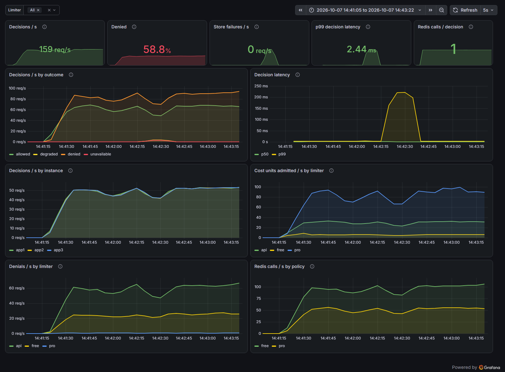
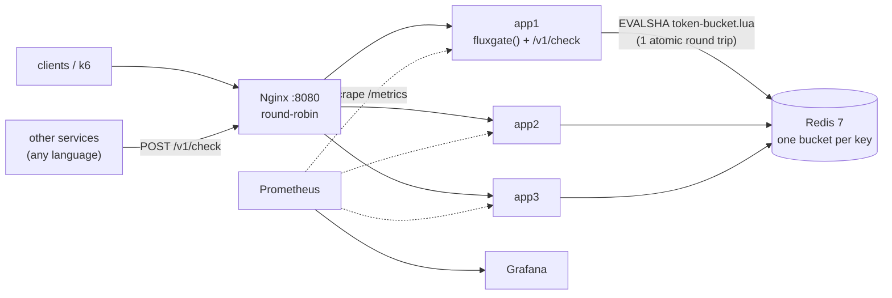
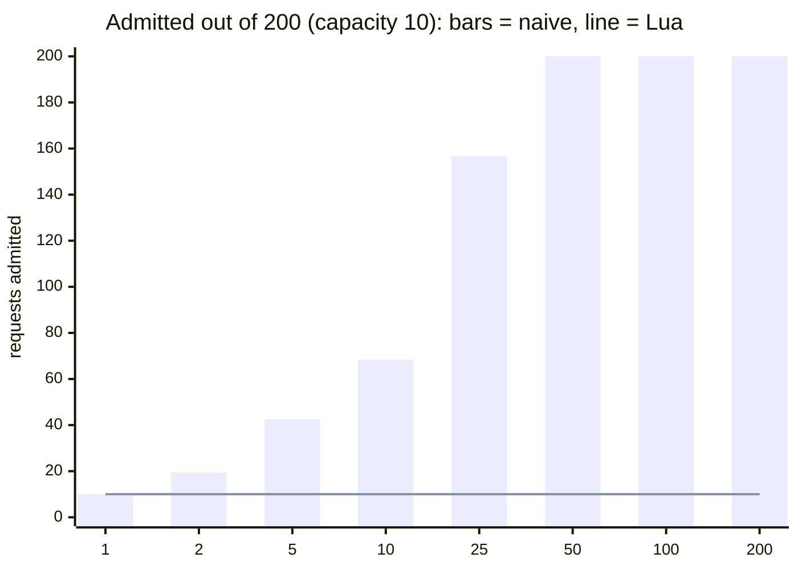
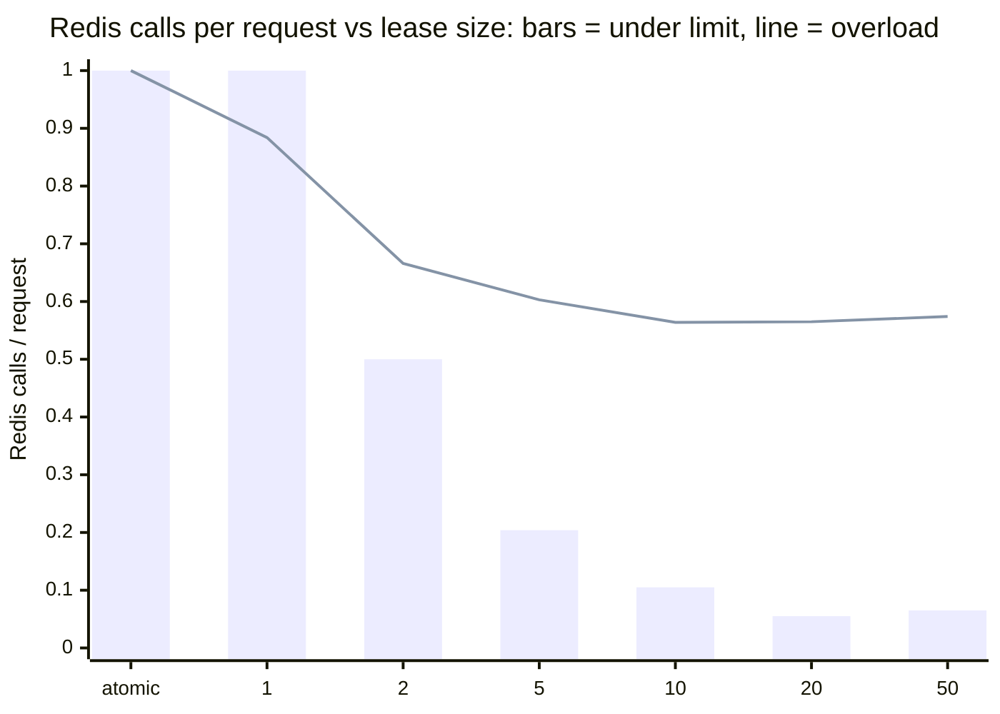
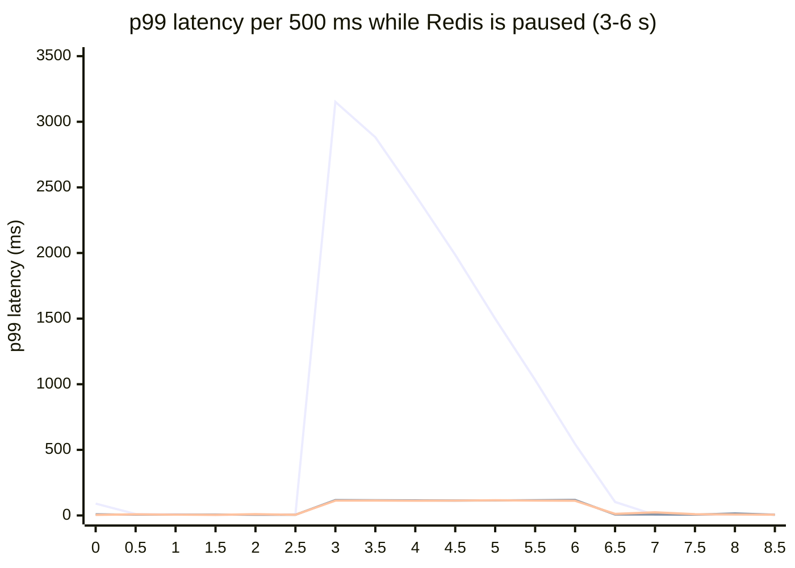

# FluxGate

**Rate limiting for APIs that run on more than one server: fair to your users, consistent across instances, and honest about what happens when Redis fails. Built from first principles and measured end to end.**

[](.github/workflows/ci.yml)     

## How is it useful to you?

If you run an API, sooner or later someone sends it more than it can take: a scraper, a retry loop with no backoff, a customer's script stuck in a `while (true)`, or one user burning through your LLM budget overnight. A rate limiter is what says "not so fast", and it has to get three things right. It must be **fair**, so one caller can't starve the rest. It must be **consistent**, so the limit holds no matter which of your servers gets the request. And it must be **safe**, so the limiter itself never becomes the reason your API is down. FluxGate is built around those three promises, and each one is backed by a measurement in this repository, not a claim.

| If you are… | your problem is… | and FluxGate gives you… |
|---|---|---|
| running one Express, Fastify, Hono or Next.js app | one noisy client slows everyone down | one line of middleware and the standard `429` + `Retry-After` that HTTP clients and SDKs already understand |
| selling plans (free, pro, enterprise) | each customer should get what they paid for | per-key tiers: `byTier({ tiers: { free, pro } })` |
| building on an LLM or any metered API | requests aren't equal: one prompt can cost 100× another | **weighted cost**: charge each request in tokens, rows or bytes. A request that can never fit gets `413`, not a `429` that clients retry forever |
| scaling out to several instances | each server counts on its own, so 3 servers allow 3× the limit | one atomic Redis store: measured at **0.98×** the limit across 3 instances, against **2.9×** without it |
| running services in Python, Go, or at the edge | you don't want to re-implement limits in every language | **service mode**: one `POST /v1/check` over HTTP, plus a TypeScript client |
| on call | you hear about abuse from the bill or the outage | Prometheus `/metrics` and a ready-made **Grafana dashboard**: allowed vs denied, p99 decision time, Redis load |
| worried about Redis | a limiter that hangs when Redis freezes takes the whole API with it | a bounded wait (measured p99 **116 ms** instead of **3.1 s**) and an explicit choice: serve anyway (fail open) or reject (fail closed) |

Small decisions follow from the same question, "what does the person using this need?":

- **It works with no configuration.** The default key is the `x-api-key` header, falling back to the client IP, and the defaults are sensible.
- **Every rejection tells the client what to do next.** `429` means "wait `Retry-After` seconds". `413` means "this request is too big for your plan". `503` means "the limiter is down and this route fails closed".
- **You install only what you need.** The algorithms have zero dependencies; Redis, the framework adapters and the service are separate packages.
- **The metrics stay safe.** They are never labelled by customer key, so your Prometheus can't be taken down by a million time series.

## Pick your setup

| Setup | When to use it | Packages | Measured cost per decision (p50) |
|---|---|---|---|
| **In-process** | one server, prototypes, per-instance protection | `@flux-gate/core` + `@flux-gate/http` | 0.001 ms |
| **Shared Redis** | several instances of a Node app, one global limit | `@flux-gate/redis` + `@flux-gate/http` | ≈ 1 ms (one Redis round trip); ≈ 0.01 ms when a token lease answers |
| **Service** | many apps, many languages, edge or serverless runtimes | run `@flux-gate/server`, call it with `@flux-gate/client` or plain HTTP | ≈ 1.1 ms (one HTTP hop, leasing inside the service) |

All numbers are from [the benchmarks below](#results), on one laptop.

## Packages

| Package | What it is |
|---|---|
| [`@flux-gate/core`](packages/core) | Five algorithms as pure, synchronous, zero-dependency classes with an injectable clock: **fixed window, sliding window log, sliding window counter, token bucket, GCRA.** Every one supports weighted cost. |
| [`@flux-gate/redis`](packages/redis) | Distributed stores: the **atomic Lua** token bucket, the **leased** bucket (borrows tokens in batches), and the **naive** one kept on purpose as the "before". Includes a Redis client tuned to fail fast. |
| [`@flux-gate/http`](packages/http) | One decision function, `createCheck()`, plus adapters for **Express, Fastify, Hono and the Fetch API** (Next.js, Bun, Deno, Cloudflare Workers). Standard headers, tiers, a limiter timeout, fail-open / fail-closed and **Prometheus metrics**. |
| [`@flux-gate/client`](packages/client) | `FluxgateClient` for service mode. `client.policy('free')` plugs into any adapter like a local limiter. |
| [`@flux-gate/server`](packages/server) | The deployable app: `POST /v1/check` with named policies, `GET /metrics`, a demo API, all configured by environment variables. |
| [`bench`](packages/bench) | Six reproducible experiments that write `results/*.json`. `npm run report` renders them into the tables below. |

> **Not on npm yet.** Until the first release, clone the repository: `npm install` links the packages to each other as a workspace.

## Quick start

Requirements: Node.js 20+ and Docker.

```bash
npm install
npm test                      # 117 tests; the Redis integration tests run when Redis is reachable

docker compose up -d --build  # Redis + 3 app instances + Nginx on :8080
curl -i localhost:8080/api/hello
```

```http
HTTP/1.1 200 OK
X-Instance-Id: app2
X-RateLimit-Limit: 20
X-RateLimit-Remaining: 19
X-RateLimit-Reset: 1
```

Hammer one key and watch the limit hold across instances:

```bash
docker compose --profile bench run --rm k6                   # correct: about 40 admitted
STORE=memory docker compose up -d                            # switch every instance to in-memory
STORE=memory docker compose --profile bench run --rm k6      # broken: about 3x the limit
```

## Use it in your app

### Express, with plans

```ts
import express from 'express';
import { connectRedis, RedisTokenBucket } from '@flux-gate/redis';
import { byTier } from '@flux-gate/http';
import { fluxgate } from '@flux-gate/http/express';

const redis = await connectRedis({ url: process.env.REDIS_URL });
const plans = new Map([['key:abc123', 'pro']]); // keys look like 'key:<x-api-key>' or 'ip:<addr>'; in production, your API-key store
const free = new RedisTokenBucket(redis, { capacity: 20, refillPerSecond: 2, prefix: 'rl:free:' });
const pro = new RedisTokenBucket(redis, { capacity: 200, refillPerSecond: 50, prefix: 'rl:pro:' });

const app = express();
app.use('/api', fluxgate({
  limiter: byTier({ tiers: { free, pro }, tierOf: (key) => plans.get(key) ?? 'free', fallback: 'free' }),
  failMode: 'open',   // Redis down? serve the request, mark it X-RateLimit-Status: degraded
  timeoutMs: 100,     // a slow limiter counts as a failed one
}));
```

### Fastify and Hono

```ts
import { TokenBucketLimiter } from '@flux-gate/core';
import { fluxgate } from '@flux-gate/http/fastify';

const limiter = new TokenBucketLimiter({ capacity: 20, refillPerSecond: 2 });
app.addHook('onRequest', fluxgate({ limiter }));
```

```ts
import { fluxgate } from '@flux-gate/http/hono';

app.use('/api/*', fluxgate({ limiter, key: (c) => c.req.header('x-api-key') ?? 'anonymous' }));
```

### Next.js: limit an LLM endpoint by tokens, not requests

The same adapter works for anything built on `Request` and `Response`: Bun, Deno and Cloudflare Workers too.

```ts
// app/api/chat/route.ts
import { RedisTokenBucket } from '@flux-gate/redis';
import { withRateLimit } from '@flux-gate/http/fetch';
import { redis } from '@/lib/redis'; // your connectRedis() client

// Each key gets a burst of 50,000 tokens, refilled at 500 per second (30,000 a minute).
const tokens = new RedisTokenBucket(redis, { capacity: 50_000, refillPerSecond: 500, prefix: 'rl:llm:' });

export const POST = withRateLimit(
  {
    limiter: tokens,
    key: (req) => req.headers.get('x-api-key') ?? 'anonymous',
    cost: async (req) => (await req.clone().json()).max_tokens ?? 1000,
  },
  async (req) => Response.json(await answer(req)),
);
```

A request for 2,000 tokens is admitted only if 2,000 single-token requests in a row would be, so the limit means the same thing in units as it did in requests. A denied request is charged nothing, and a request for more than 50,000 tokens gets `413` straight away.

### No framework at all

```ts
import { createCheck } from '@flux-gate/http';

const check = createCheck({ limiter, failMode: 'closed', timeoutMs: 100 });
const decision = await check('user:42', { cost: 5 });
if (!decision.allowed) {
  // decision.rejection.status is 413, 429 or 503; decision.headers includes Retry-After
}
```

### Service mode: one rate limiter for every app and language

Run the server once, with named policies:

```bash
docker compose up -d --build     # the app instances already serve POST /v1/check behind Nginx on :8080

# or as a single process:
npm run build
STORE=memory SERVICE_TOKEN=s3cret PORT=3100 \
POLICIES='{"free":{"capacity":20,"refillPerSecond":2},"login":{"capacity":5,"refillPerSecond":0.1}}' \
node packages/server/dist/main.js
```

Then ask it from anywhere:

```bash
curl -s localhost:3100/v1/check -H 'authorization: Bearer s3cret' \
  -H 'content-type: application/json' -d '{"policy":"login","key":"ip:203.0.113.7"}'
```

```json
{"allowed":true,"limit":5,"remaining":4,"resetMs":10000}
```

From TypeScript, a policy behaves like a local limiter in any adapter:

```ts
import { FluxgateClient } from '@flux-gate/client';
import { fluxgate } from '@flux-gate/http/express';

const ratelimit = new FluxgateClient({ url: 'http://ratelimit:3000', token: process.env.FLUXGATE_TOKEN });
app.use('/api', fluxgate({ limiter: ratelimit.policy('free'), failMode: 'open' }));

const login = await ratelimit.check({ policy: 'login', key: `ip:${req.ip}` });
```

From Python, it's one request:

```python
r = requests.post("http://ratelimit:3000/v1/check", json={"policy": "login", "key": f"ip:{ip}"},
                  headers={"authorization": f"Bearer {token}"}, timeout=0.1)
r.raise_for_status()          # 4xx/5xx: no decision, so apply your fail mode
if not r.json()["allowed"]:
    return "Too many requests", 429
```

The contract keeps "your user is over the limit" separate from "the rate-limit service has a problem":

| Status | Meaning | What the caller does |
|---|---|---|
| `200` | A decision, **allowed or denied**, in the body | Follow `allowed`. On a denial, use `retryAfterMs`; if it's absent, the request can never fit. |
| `400` | Bad input, or `unknown_policy` (the response lists the valid ones) | Fix the call. |
| `401` | Missing or wrong token | Fix the configuration. |
| `503` | The service's store (Redis) is unavailable | Apply your own fail mode: the client throws, so the adapters fail open or closed as you chose. |

## Observability

```bash
docker compose --profile observability up -d   # adds Prometheus (:9090) and Grafana (:3001)
```

Open http://localhost:3001. The FluxGate dashboard opens read-only, without a login.



<sub>A load test with a Redis pause partway through: the p99 decision time spikes to about 220 ms and recovers as soon as Redis is back.</sub>

Every app exposes `GET /metrics` in the Prometheus text format (written from scratch, no `prom-client`):

| Metric | Type | Labels |
|---|---|---|
| `fluxgate_decisions_total` | counter | `limiter`, `outcome` (allowed, denied, degraded, unavailable) |
| `fluxgate_cost_units_total` | counter | `limiter`, `outcome` |
| `fluxgate_limiter_duration_seconds` | histogram | `limiter`, `outcome` |
| `fluxgate_redis_calls_total` | counter | `policy` |

Nginx blocks `/metrics` from the outside; Prometheus scrapes each instance directly. To add metrics to your own app:

```ts
import { Metrics } from '@flux-gate/http';

const metrics = new Metrics();
app.use('/api', fluxgate({ limiter, metrics, name: 'api' }));
app.get('/metrics', (_req, res) => {
  res.setHeader('Content-Type', metrics.contentType);
  res.end(metrics.render());
});
```

## How it works



The app instances are **stateless**. All limiter state lives in Redis, so a client's limit is global no matter which instance Nginx routes it to. Redis runs each Lua script to completion before anything else, which makes "read the bucket, refill, decide, write back" a single indivisible step. The script reads time from Redis's own clock (`TIME`), so clock skew between app servers can't create tokens.

No rate-limiting libraries are used. The only runtime dependencies are `ioredis` (a Redis client) and `express` (for the server); the framework adapters use your framework as a peer dependency. Every algorithm, the Lua script, the adapters, the metrics format and the benchmarks are written from scratch in TypeScript.

## Results

The project follows one loop: **build it, break it, measure it, fix it.**

| | Finding | Evidence |
|---|---|---|
| 🔴 | An in-memory limiter behind 3 load-balanced instances allows **2.9× the limit**. | [k6, end to end](#4-end-to-end-3-instances-behind-nginx) |
| 🔴 | A shared Redis limiter written as GET → compute → SET allows up to **20× the limit** under concurrency. `MULTI` doesn't fix it. | [race experiment](#1-the-race-condition-and-its-fix) |
| 🟢 | Moving read-decide-write into one Lua script admits **exactly the limit** in every trial, from 1 to 200 concurrent clients. It also uses one round trip instead of two. | same |
| 🟢 | With a stock Redis client, a frozen Redis makes every request **hang for up to 3.1 s**. Fail-fast settings plus a 100 ms limiter timeout bring the p99 to **116 ms**, and you choose whether to allow (fail-open) or reject (fail-closed). | [failover experiment](#5-what-happens-when-redis-freezes) |
| 🧪 | Token leasing (borrowing tokens from Redis in batches) cuts Redis calls by **18×** below the limit (0.055 per request) with no measurable over-admission, at the cost of rare false denials. | [leasing experiment](#3-token-leasing-fewer-redis-calls-for-a-little-precision) |
| 🧪 | The HTTP layer (timeout, headers, metrics) adds **no measurable latency**. Service mode costs **one HTTP hop**, and with leasing inside the service it makes **0.05 Redis calls** per decision. | [service experiment](#6-service-mode-what-a-network-hop-costs) |

Every number below is produced by `npm run bench` (Redis must be running) and inserted by `npm run report`. None are typed by hand. The full method and discussion are in **[docs/REPORT.md](docs/REPORT.md)**.

### 1. The race condition and its fix

A bucket of capacity 10 receives 200 requests from *C* concurrent clients. The correct answer is always 10.

<!-- results:race:start -->


| concurrent clients | naive: admitted (mean / max) | naive: × limit | Lua: admitted (mean / max) | Lua: × limit |
| --- | --- | --- | --- | --- |
| 1 | 10 / 10 | 1× | 10 / 10 | 1× |
| 2 | 19.4 / 20 | 1.94× | 10 / 10 | 1× |
| 5 | 42.6 / 50 | 4.26× | 10 / 10 | 1× |
| 10 | 68.4 / 71 | 6.84× | 10 / 10 | 1× |
| 25 | 156.8 / 169 | 15.68× | 10 / 10 | 1× |
| 50 | 200 / 200 | 20× | 10 / 10 | 1× |
| 100 | 200 / 200 | 20× | 10 / 10 | 1× |
| 200 | 200 / 200 | 20× | 10 / 10 | 1× |

<sub>5 trials per cell, 200 requests for one key, each client on its own Redis connection. Source: `results/race.json`.</sub>
<!-- results:race:end -->

The naive limiter reads the bucket, decides in JavaScript, then writes it back. Between the read and the write, other clients read the same old value, and they all spend the same token. Wrapping the write in `MULTI` doesn't help, because the decision was already made on stale data. The Lua version does the same arithmetic inside Redis, where nothing can interleave.

### 2. Algorithm accuracy

Does each algorithm keep "at most 100 requests in any 60 s"?

<!-- results:accuracy:start -->
**Peak admitted in any 60 s window, as a multiple of the limit** (1.00 = never exceeded):

| algorithm | light<br><sub>Poisson, 0.5x the limit</sub> | normal<br><sub>Poisson, 0.9x the limit</sub> | steady<br><sub>Poisson, 1.5x the limit</sub> | bursty<br><sub>on/off, 10x spikes</sub> | adversarial<br><sub>full limit on both sides of every boundary</sub> |
| --- | --- | --- | --- | --- | --- |
| sliding-log (exact) | 0.77× | 1.00× | 1.00× | 1.00× | 1.00× |
| fixed-window | 0.77× | 1.23× | 1.43× | 2.00× | 2.00× |
| sliding-counter | 0.77× | 1.13× | 1.10× | 1.59× | 1.01× |
| token-bucket | 0.77× | 1.23× | 1.67× | 1.99× | 1.01× |
| gcra | 0.77× | 1.23× | 1.67× | 1.99× | 1.01× |

**Wrong decisions, judged against the definition "at most `limit` in any window"** (wrong allow / wrong deny, % of all requests):

| algorithm | light | normal | steady | bursty | adversarial |
| --- | --- | --- | --- | --- | --- |
| sliding-log (exact) | 0% / 0% | 0% / 0% | 0% / 0% | 0% / 0% | 0% / 0% |
| fixed-window | 0% / 0% | 12.899% / 0% | 33.402% / 0% | 14.767% / 0% | 50% / 0% |
| sliding-counter | 0% / 0% | 7.308% / 0.535% | 20.972% / 8.658% | 7.168% / 30.048% | 0.5% / 0% |
| token-bucket | 0% / 0% | 16.507% / 0% | 34.539% / 0% | 17.521% / 0% | 0.5% / 0% |
| gcra | 0% / 0% | 16.507% / 0% | 34.539% / 0% | 17.521% / 0% | 0.5% / 0% |

<sub>Limit 100 per 60 s, 2 simulated hours per pattern, seeded PRNG (deterministic). Token bucket and GCRA are configured as capacity = limit, refill = limit / window; they intentionally allow bursts, so they are shown for reference, not judged as "wrong". Source: `results/accuracy.json`.</sub>
<!-- results:accuracy:end -->

- **Fixed window** lets an attacker who knows the window edges get **2× the limit**.
- The **sliding counter** (Cloudflare's approach, 2 integers per key) closes most of that gap. Its error grows with load: 0% wrong decisions on light traffic, and over-admission of up to 1.59× when bursts end just before a window boundary.
- **Token bucket and GCRA make identical decisions.** That's verified on random traffic in the unit tests. GCRA stores 1 number per key instead of 2.

### 3. Token leasing: fewer Redis calls for a little precision

<!-- results:leasing:start -->


| load | limiter | requests | admitted | vs atomic | peak in 1 s (bound) | Redis calls / req | p50 (ms) | p99 (ms) |
| --- | --- | --- | --- | --- | --- | --- | --- | --- |
| under | atomic (no lease) | 399 | 399 | 1× | 76 (150) | 1 | 1.526 | 5.766 |
| under | lease 1 | 399 | 399 | 1× | 77 (150) | 1 | 1.542 | 4.31 |
| under | lease 2 | 398 | 398 | 0.997× | 75 (150) | 0.5 | 1.185 | 3.311 |
| under | lease 5 | 398 | 398 | 0.997× | 75 (150) | 0.204 | 0.018 | 2.436 |
| under | lease 10 | 399 | 399 | 1× | 76 (150) | 0.105 | 0.013 | 2.167 |
| under | lease 20 | 398 | 398 | 0.997× | 75 (150) | 0.055 | 0.011 | 1.982 |
| under | lease 50 | 398 | 395 | 0.99× | 75 (150) | 0.065 | 0.012 | 2.273 |
| overload | atomic (no lease) | 1071 | 649 | 1× | 149 (150) | 1 | 1.389 | 3.398 |
| overload | lease 1 | 1069 | 649 | 1× | 149 (150) | 0.884 | 1.701 | 5.055 |
| overload | lease 2 | 1071 | 650 | 1.002× | 148 (150) | 0.666 | 1.319 | 3.977 |
| overload | lease 5 | 1071 | 649 | 1× | 148 (150) | 0.603 | 1.279 | 3.178 |
| overload | lease 10 | 1070 | 649 | 1× | 147 (150) | 0.564 | 1.249 | 3.117 |
| overload | lease 20 | 1071 | 649 | 1× | 147 (150) | 0.565 | 1.264 | 3.171 |
| overload | lease 50 | 1071 | 649 | 1× | 150 (150) | 0.574 | 1.252 | 2.947 |

<sub>3 instances sharing one bucket (capacity 50, refill 100/s); Poisson load of 25 (under) or 60 (overload) req/s per instance for 6 s; lease TTL 1000 ms. Source: `results/leasing.json`.</sub>
<!-- results:leasing:end -->

### 4. End to end: 3 instances behind Nginx

<!-- results:k6:start -->
| store | load | requests | allowed | correct global limit | allowed per instance (app1/app2/app3) | p99 (ms) |
| --- | --- | --- | --- | --- | --- | --- |
| `memory` | 100 req/s × 10 s | 1001 | **117** | 40 (2.93×) | 39 / 39 / 39 | 3.6 |
| `redis-naive` | 100 req/s × 10 s | 1001 | **39** | 40 (0.98×) | 12 / 14 / 13 | 6.1 |
| `redis-lua` | 100 req/s × 10 s | 1001 | **39** | 40 (0.98×) | 14 / 13 / 12 | 4 |
| `redis-leased` | 100 req/s × 10 s | 1001 | **39** | 40 (0.98×) | 21 / 11 / 7 | 3.5 |
| `redis-naive` | 2000 req/s × 5 s | 9416 | **159** | 30 (5.3×) | 54 / 58 / 47 | 359.2 |
| `redis-lua` | 2000 req/s × 5 s | 9831 | **29** | 30 (0.97×) | 11 / 10 / 8 | 77.7 |

<sub>k6 (constant arrival rate) → Nginx round-robin → 3 app instances → 1 Redis, all in Docker Compose. One API key, free tier (capacity 20, refill 2/s), so the correct total is 20 + 2 × seconds. Source: `results/k6-*.json`.</sub>
<!-- results:k6:end -->

At 100 req/s the naive store looks correct because requests rarely overlap. At 2000 req/s they do, and it admits 5.3× the limit. **A race condition that only shows up under load is exactly the kind of bug that passes code review and staging.**

### 5. What happens when Redis freezes

`docker compose pause redis` for 3 s during 200 req/s. The connection stays open but nothing answers, which is the hardest failure to detect.

<!-- results:failover:start -->


<sub>Lines, top to bottom: library defaults, fail-open, fail-closed (fail-open and fail-closed overlap at about 115 ms).</sub>

| configuration | requests during outage | served (HTTP 200) | p50 (ms) | p99 (ms) | what the client saw |
| --- | --- | --- | --- | --- | --- |
| library defaults | 610 | 100% | 1840 | 3137 | requests hang until Redis returns |
| fail-open | 610 | 100% | 111 | 116 | 200 + `X-RateLimit-Status: degraded` (unlimited) |
| fail-closed | 610 | 9.7% | 110 | 115 | 503 Service Unavailable |

<sub>200 req/s open-loop against the real Express app; `docker compose pause redis` at 3 s, `unpause` at 6 s (the commands take ~0.3 s to land, so the edge slices are mixed). "Served" counts requests sent during the pause window. Source: `results/failover.json`.</sub>
<!-- results:failover:end -->

### 6. Service mode: what a network hop costs

The same decision made four ways: the bare limiter, the HTTP layer every adapter uses, a do-nothing `node:http` server (the floor for *any* HTTP service on this machine), and the real FluxGate service as a separate process.

<!-- results:service:start -->
| mode | store | in flight | p50 (ms) | p99 (ms) | throughput (decisions/s) | Redis calls / decision |
| --- | --- | --- | --- | --- | --- | --- |
| in-process consume() | memory | 1 | 0.001 | 0.017 | 242,281 | 0 |
| in-process consume() | memory | 64 | 0.072 | 0.319 | 428,019 | 0 |
| in-process check() + metrics | memory | 1 | 0.001 | 0.002 | 399,675 | 0 |
| in-process check() + metrics | memory | 64 | 0.055 | 0.674 | 501,901 | 0 |
| in-process consume() | redis-lua | 1 | 1.117 | 3.158 | 761 | 1 |
| in-process consume() | redis-lua | 64 | 7.892 | 15.386 | 7,669 | 1 |
| in-process check() + metrics | redis-lua | 1 | 0.972 | 3.427 | 865 | 1 |
| in-process check() + metrics | redis-lua | 64 | 7.318 | 14.782 | 8,177 | 1 |
| HTTP hop only (bare node:http) | - | 1 | 0.884 | 4.116 | 985 | 0 |
| HTTP hop only (bare node:http) | - | 64 | 42.839 | 136.207 | 1,343 | 0 |
| service (HTTP) | memory | 1 | 1.323 | 4.551 | 661 | 0 |
| service (HTTP) | memory | 64 | 44.926 | 101.358 | 1,322 | 0 |
| service (HTTP) | redis-lua | 1 | 3.016 | 10.996 | 285 | 1 |
| service (HTTP) | redis-lua | 64 | 75.344 | 161.719 | 809 | 1 |
| service (HTTP) | redis-leased | 1 | 1.117 | 5.337 | 690 | 0.05 |
| service (HTTP) | redis-leased | 64 | 46.404 | 90.56 | 1,276 | 0.05 |

<sub>latency per decision in ms; client, service and Redis 7.4 (Docker Desktop) on one Windows 11 machine, Node v22.17.0. "service" = `@flux-gate/client` → HTTP → the FluxGate server as a separate process (lease size 20 for redis-leased). One hot key, nothing denied. Source: `results/service.json`.</sub>
<!-- results:service:end -->

- **`check()` costs nothing you can measure.** The timeout race, headers and three metric updates are lost in the noise next to a bare `consume()`.
- **The service is one hop.** With an in-memory store it's about 0.4 ms slower than the do-nothing server. Both flatten at the same throughput, which is the ceiling of one Node client process on Windows loopback, not of FluxGate.
- **With leasing, the service also stops paying for Redis**: 0.05 calls per decision, and latency back at the one-hop floor. With plain `redis-lua`, every decision pays two hops (HTTP plus Redis).

Service mode buys language independence and policies managed in one place for about one millisecond per decision. Put latency-critical paths on an in-process adapter talking to Redis directly; let everything else share the service.

### Decision cost per store

<!-- results:latency:start -->
| store | in flight | p50 (ms) | p99 (ms) | throughput (decisions/s) | Redis calls / request |
| --- | --- | --- | --- | --- | --- |
| memory (single instance) | 1 | 0.001 | 0.003 | 712,393 | 0 |
| memory (single instance) | 64 | 0.031 | 0.147 | 1,600,999 | 0 |
| redis-naive (2 round trips) | 1 | 3.334 | 10.629 | 271 | 2 |
| redis-naive (2 round trips) | 64 | 14.346 | 37.883 | 3,995 | 2 |
| redis-lua (1 round trip) | 1 | 0.881 | 2.691 | 942 | 1 |
| redis-lua (1 round trip) | 64 | 4.113 | 7.81 | 14,859 | 1 |
| redis-leased (lease 20) | 1 | 0 | 0.818 | 26,308 | 0.05 |
| redis-leased (lease 20) | 64 | 2.578 | 7.884 | 20,795 | 0.05 |

<sub>consume() latency in ms, measured in-process; Redis 7.4 in Docker Desktop on the same machine. One process, one connection. Source: `results/latency.json`.</sub>
<!-- results:latency:end -->

## Design notes

- **Absent key = full bucket.** The Lua script sets the key's TTL to the time until the bucket would be full again. Idle clients cost zero memory, and Redis cleans up after itself.
- **Redis is the only clock.** Each app instance's `Date.now()` can disagree with the others. The script uses `redis.call('TIME')`.
- **Fail fast, then apply a policy.** By default, ioredis queues commands and retries while Redis is down. That's right for a cache and wrong for a limiter. The client here uses a 250 ms command timeout, 1 retry and no offline queue, and the HTTP layer adds its own timeout.
- **Weighted cost keeps every guarantee.** A cost-N request is admitted only if N cost-1 requests in a row would be. A denial charges nothing, and the Lua script and the token leases use the same rule.
- **Rate limit by the right IP.** Behind Nginx, every request arrives from Nginx's IP. The app trusts exactly **one** proxy hop and reads the rightmost `X-Forwarded-For` entry, which is the one Nginx wrote. A client can't spoof it by sending its own header.
- **`/health` is never rate limited,** so a busy instance isn't marked dead by its load balancer.

The detailed reasoning behind every file and decision, including the trade-offs I chose *not* to make, is in **[docs/DESIGN.md](docs/DESIGN.md)**.

## Limitations

- **One Redis is a single point of failure.** Fail-open/closed decides what happens when it fails; it doesn't prevent the failure. For production, use Redis Sentinel or Cluster with keys hashed by client (`{key}` hash tags), and accept that a failover can briefly reset buckets.
- **Service mode is one more thing to run.** It adds a network hop and a dependency in front of every request. The client's 100 ms default timeout and your fail mode bound the damage, but they don't remove it.
- **In-memory limiters never evict idle keys.** That's fine for the benchmarks, but a long-running in-memory deployment needs an LRU or periodic sweep.
- **Latency numbers come from Docker Desktop on Windows,** where container networking adds roughly 0.5–1 ms per hop. Compare the rows with each other, not with numbers from Linux.
- **Not implemented:** Redis Cluster and the IETF `RateLimit` / `RateLimit-Policy` headers.

## Repository layout

```
packages/core     five algorithms + unit tests (no I/O, no dependencies)
packages/redis    lua/token-bucket.lua, naive / atomic / leased stores, integration tests
packages/http     createCheck(), Express / Fastify / Hono / Fetch adapters, tiers, Prometheus metrics
packages/client   FluxgateClient for service mode
packages/server   POST /v1/check, /metrics, demo API, env config
packages/bench    six experiments → results/*.json → report
docker/           Dockerfile (multi-stage, non-root), nginx.conf, prometheus.yml, grafana/ (provisioned dashboard)
k6/               end-to-end load test through Nginx
docs/             DESIGN.md (how and why), REPORT.md (method and results), images/
```

## License

[MIT](LICENSE) © Krish Vaghasia
