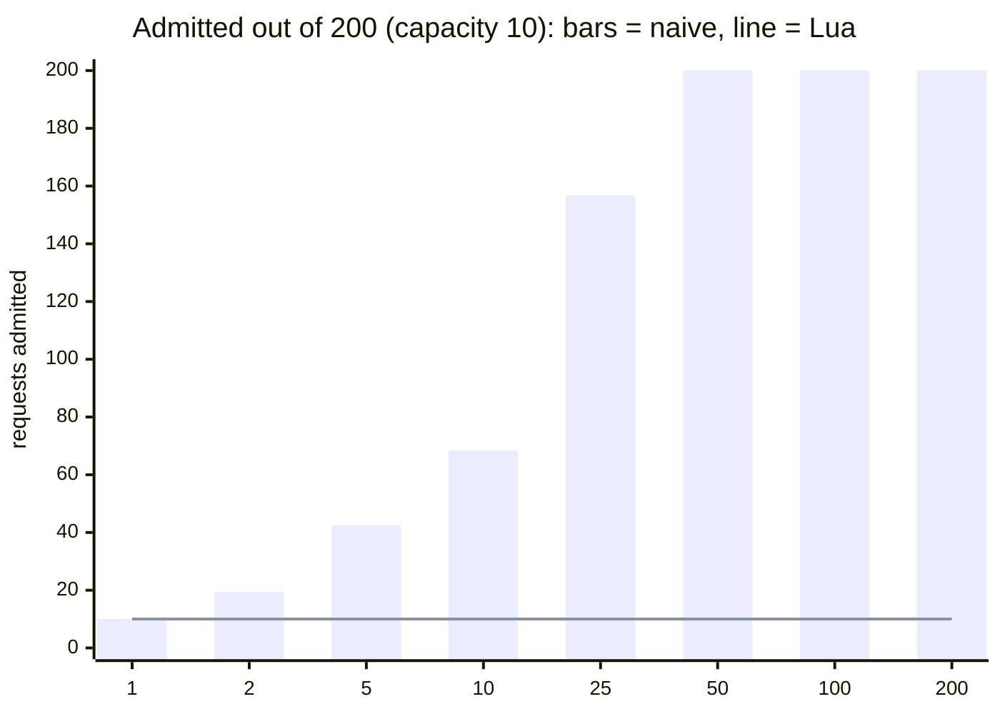
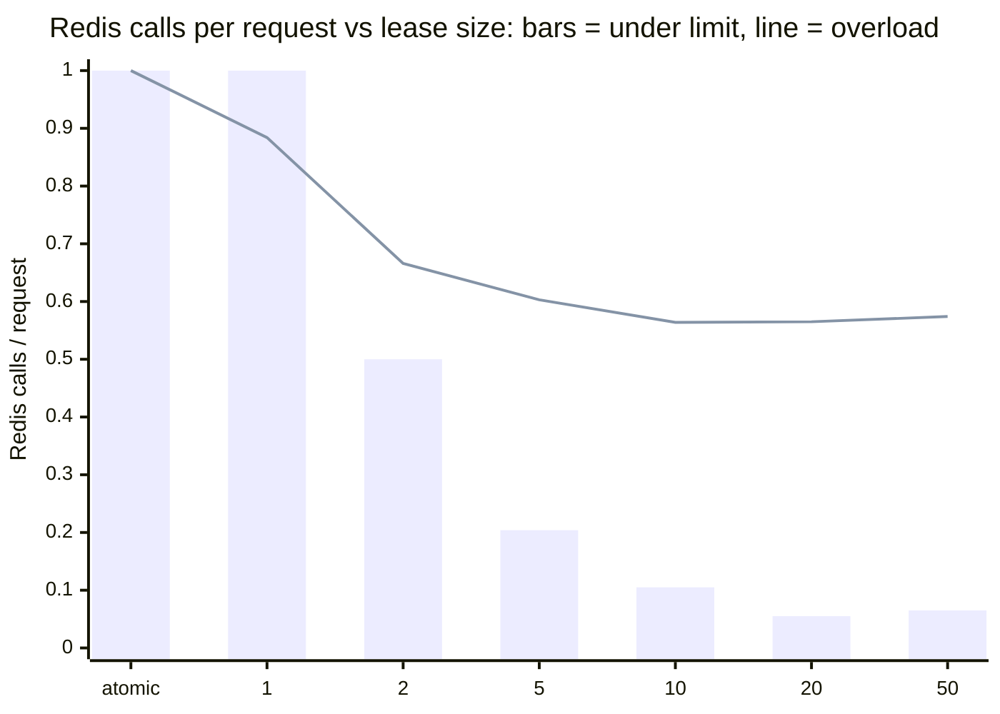
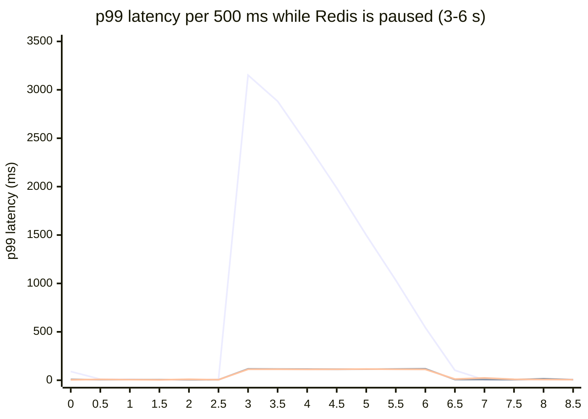

# FluxGate: an empirical look at distributed rate limiting

*Krish Vaghasia, 2026*

## Abstract

Rate limiters are usually described by their algorithm, but in a horizontally scaled service most of their failures come from somewhere else: shared state that isn't updated atomically, clocks that disagree, and a dependency (the shared store) that can stall. I implemented five rate-limiting algorithms and three Redis-backed distributed stores from scratch, then ran six experiments:

1. **Atomicity.** A read-compute-write limiter on Redis over-admits in proportion to concurrency, reaching **20×** the limit at 50 concurrent clients. A single Lua script removes the error completely and halves the round trips.
2. **Accuracy.** The sliding-window counter's approximation is exact under light load. Under bursty overload it errs in *both* directions: peaks of 1.59× the limit, and 30% of requests falsely denied.
3. **Leasing.** Batching tokens locally cuts Redis traffic by 18× below the limit. At saturation the savings shrink, because the bucket refills one token at a time and leases can't form.
4. **Failure.** With a default client, a frozen Redis turns every request into a multi-second hang (p99 3.1 s). Bounded timeouts reduce that to ~115 ms and make "fail open" vs "fail closed" an explicit policy choice.
5. **End to end.** In a 3-instance deployment behind Nginx, per-instance memory admits 2.9× the limit; the atomic store admits 0.98×.
6. **Layers.** The framework-agnostic HTTP layer (timeout, headers, Prometheus metrics) adds no measurable latency. Running the limiter as a separate service costs one HTTP hop (p50 ≈ 1.3 ms here), and the FluxGate server itself is within noise of a bare `node:http` server. With token leasing inside the service, it stays at that floor while making 0.05 Redis calls per decision.

## 1. Questions

- **Q1.** How much does a non-atomic distributed limiter over-admit, and how does that scale with concurrency?
- **Q2.** How far from the exact definition ("at most *L* requests in any window *W*") do the cheaper algorithms drift, and on what traffic?
- **Q3.** What does token leasing trade, in accuracy and Redis load, as the lease size grows?
- **Q4.** What does the client experience when the limiter's store stops responding, and what controls that?
- **Q5.** Do the in-process results survive a real deployment (load balancer, containers, HTTP)?
- **Q6.** What does it cost to put the limiter behind a framework-agnostic HTTP layer, or behind a network service?

## 2. System under test

- **Algorithms (`@flux-gate/core`).** Fixed window, sliding window log (exact reference), sliding window counter (Cloudflare's weighted estimate), token bucket (continuous refill), and GCRA. All are synchronous and take an explicit `now`, so experiments are deterministic.
- **Stores (`@flux-gate/redis`).** All three implement a token bucket:
  - **naive**: `HMGET` → `tokenBucketStep()` in JS → `MULTI HSET PEXPIRE`. It uses the *same* pure function as the in-memory bucket, so the only variable is atomicity.
  - **atomic**: the same arithmetic in one Lua script (`EVALSHA`), using Redis `TIME` as the clock.
  - **leased**: takes up to *N* tokens per script call and serves later requests from local memory until the lease runs out or its TTL expires. Concurrent misses share one in-flight call, and a denial is cached until its `retry-after`.
- **HTTP layer (`@flux-gate/http`).** One decision function, `check()`, with tiers, standard headers, a limiter timeout, fail-open / fail-closed and Prometheus metrics, wrapped by adapters for Express, Fastify, Hono and the Fetch API.
- **Service (`@flux-gate/server`, `@flux-gate/client`).** `POST /v1/check` with named policies, so apps that can't or shouldn't talk to Redis get the same limits over HTTP.

## 3. Setup

| | |
|---|---|
| Machine | Intel Core i5-1335U (12 threads), 16 GB RAM, Windows 11 |
| Runtime | Node.js 22.17, TypeScript 7, ioredis 6 |
| Redis | 7.4.11 in Docker Desktop 27.4 (WSL2), persistence off |
| Load generation | in-process open-loop (Poisson) generators; k6 0.54 for the end-to-end run |

**Open loop.** All load generators are *open loop*: requests are sent at Poisson-distributed times regardless of whether earlier ones have finished. A closed loop (send, wait, send) hides latency problems, because a slow server automatically receives less load. All random traffic uses a seeded PRNG, so the accuracy experiment is bit-for-bit reproducible. The Redis experiments are reproducible up to scheduling noise.

## 4. Results

### 4.1 Atomicity (Q1)

**Method.** Capacity 10, refill ≈ 0, 200 requests to one key from *C* workers, each on its own Redis connection. 5 trials per cell.

<!-- results:race:start -->


| concurrent clients | naive: admitted (mean / max) | naive: × limit | Lua: admitted (mean / max) | Lua: × limit |
| --- | --- | --- | --- | --- |
| 1 | 10 / 10 | 1× | 10 / 10 | 1× |
| 2 | 19.4 / 20 | 1.94× | 10 / 10 | 1× |
| 5 | 42.6 / 50 | 4.26× | 10 / 10 | 1× |
| 10 | 68.4 / 71 | 6.84× | 10 / 10 | 1× |
| 25 | 156.8 / 169 | 15.68× | 10 / 10 | 1× |
| 50 | 200 / 200 | 20× | 10 / 10 | 1× |
| 100 | 200 / 200 | 20× | 10 / 10 | 1× |
| 200 | 200 / 200 | 20× | 10 / 10 | 1× |

<sub>5 trials per cell, 200 requests for one key, each client on its own Redis connection. Source: `results/race.json`.</sub>
<!-- results:race:end -->

**Discussion.**
- Over-admission grows roughly linearly with concurrency until every request is admitted. Each of the *C* clients can read the same pre-decrement state, so up to *C* requests spend each token.
- At *C* = 1 the naive limiter is correct, which is why a single-threaded test suite would never catch the bug.
- Wrapping the write in `MULTI` doesn't help, because the decision was already made on a stale read. `WATCH`/retry would be correct but turns contention into retries.
- The Lua script was exact in all 40 runs and needs one round trip instead of two.

### 4.2 Accuracy of the algorithms (Q2)

**Method.**
- Limit 100 per 60 s, one key, 2 simulated hours per traffic pattern.
- Each algorithm is judged against the exact definition *using its own admission history*. A **wrong allow** admits a request when the limiter has already admitted 100 in the trailing 60 s. A **wrong deny** rejects one when it has admitted fewer.
- Comparing request-by-request with the exact log would be misleading: under overload, two limiters can admit the same *number* of requests but different *individual* ones.

<!-- results:accuracy:start -->
**Peak admitted in any 60 s window, as a multiple of the limit** (1.00 = never exceeded):

| algorithm | light<br><sub>Poisson, 0.5x the limit</sub> | normal<br><sub>Poisson, 0.9x the limit</sub> | steady<br><sub>Poisson, 1.5x the limit</sub> | bursty<br><sub>on/off, 10x spikes</sub> | adversarial<br><sub>full limit on both sides of every boundary</sub> |
| --- | --- | --- | --- | --- | --- |
| sliding-log (exact) | 0.77× | 1.00× | 1.00× | 1.00× | 1.00× |
| fixed-window | 0.77× | 1.23× | 1.43× | 2.00× | 2.00× |
| sliding-counter | 0.77× | 1.13× | 1.10× | 1.59× | 1.01× |
| token-bucket | 0.77× | 1.23× | 1.67× | 1.99× | 1.01× |
| gcra | 0.77× | 1.23× | 1.67× | 1.99× | 1.01× |

**Wrong decisions, judged against the definition "at most `limit` in any window"** (wrong allow / wrong deny, % of all requests):

| algorithm | light | normal | steady | bursty | adversarial |
| --- | --- | --- | --- | --- | --- |
| sliding-log (exact) | 0% / 0% | 0% / 0% | 0% / 0% | 0% / 0% | 0% / 0% |
| fixed-window | 0% / 0% | 12.899% / 0% | 33.402% / 0% | 14.767% / 0% | 50% / 0% |
| sliding-counter | 0% / 0% | 7.308% / 0.535% | 20.972% / 8.658% | 7.168% / 30.048% | 0.5% / 0% |
| token-bucket | 0% / 0% | 16.507% / 0% | 34.539% / 0% | 17.521% / 0% | 0.5% / 0% |
| gcra | 0% / 0% | 16.507% / 0% | 34.539% / 0% | 17.521% / 0% | 0.5% / 0% |

<sub>Limit 100 per 60 s, 2 simulated hours per pattern, seeded PRNG (deterministic). Token bucket and GCRA are configured as capacity = limit, refill = limit / window; they intentionally allow bursts, so they are shown for reference, not judged as "wrong". Source: `results/accuracy.json`.</sub>
<!-- results:accuracy:end -->

**Discussion.**

- **Light load.** Every algorithm is exact, because they only disagree near the limit. Cloudflare reports a 0.003% error rate for the sliding counter on production traffic. That figure is consistent with these results if most production keys sit well below their limit, which they typically do. It is a property of the traffic, not a guarantee of the algorithm.
- **Error grows with load.** At 0.9× the limit, 7.3% of the sliding counter's admissions are over the exact limit. At 1.5× it's 21%.
- **Error goes in both directions under bursts.** The counter assumes the previous window's requests were evenly spread:
  - When they were *back-loaded*, it underestimates and over-admits (peak 1.59×).
  - When they were *front-loaded*, it overestimates and denies requests the exact limiter would allow (30% of bursty requests).

  The unit tests construct both cases explicitly.
- **Fixed window** is exactly as bad as its theory: a boundary-aware client gets 2× the limit.
- **Token bucket and GCRA** made identical decisions on every request, across every pattern. The core test suite also checks this on 4 random configurations. They allow up to `capacity` of burst on top of the rate by design, so a 1.99× peak over a 60 s window isn't a defect. The adversarial pattern only gets 1.01×, because the bucket was already partly drained.

### 4.3 Token leasing (Q3)

**Method.**
- 3 limiter instances, each on its own Redis connection, share one bucket (capacity 50, refill 100/s).
- Poisson traffic at 25 req/s per instance (75 total, below the limit) or 60 req/s per instance (180 total, overload), 6 s per configuration, lease TTL 1 s.
- The baseline is the atomic limiter.
- The hard bound for any 1 s window is capacity + rate × 1 s = 150.

<!-- results:leasing:start -->


| load | limiter | requests | admitted | vs atomic | peak in 1 s (bound) | Redis calls / req | p50 (ms) | p99 (ms) |
| --- | --- | --- | --- | --- | --- | --- | --- | --- |
| under | atomic (no lease) | 399 | 399 | 1× | 76 (150) | 1 | 1.526 | 5.766 |
| under | lease 1 | 399 | 399 | 1× | 77 (150) | 1 | 1.542 | 4.31 |
| under | lease 2 | 398 | 398 | 0.997× | 75 (150) | 0.5 | 1.185 | 3.311 |
| under | lease 5 | 398 | 398 | 0.997× | 75 (150) | 0.204 | 0.018 | 2.436 |
| under | lease 10 | 399 | 399 | 1× | 76 (150) | 0.105 | 0.013 | 2.167 |
| under | lease 20 | 398 | 398 | 0.997× | 75 (150) | 0.055 | 0.011 | 1.982 |
| under | lease 50 | 398 | 395 | 0.99× | 75 (150) | 0.065 | 0.012 | 2.273 |
| overload | atomic (no lease) | 1071 | 649 | 1× | 149 (150) | 1 | 1.389 | 3.398 |
| overload | lease 1 | 1069 | 649 | 1× | 149 (150) | 0.884 | 1.701 | 5.055 |
| overload | lease 2 | 1071 | 650 | 1.002× | 148 (150) | 0.666 | 1.319 | 3.977 |
| overload | lease 5 | 1071 | 649 | 1× | 148 (150) | 0.603 | 1.279 | 3.178 |
| overload | lease 10 | 1070 | 649 | 1× | 147 (150) | 0.564 | 1.249 | 3.117 |
| overload | lease 20 | 1071 | 649 | 1× | 147 (150) | 0.565 | 1.264 | 3.171 |
| overload | lease 50 | 1071 | 649 | 1× | 150 (150) | 0.574 | 1.252 | 2.947 |

<sub>3 instances sharing one bucket (capacity 50, refill 100/s); Poisson load of 25 (under) or 60 (overload) req/s per instance for 6 s; lease TTL 1000 ms. Source: `results/leasing.json`.</sub>
<!-- results:leasing:end -->

**Discussion.**

- **Below the limit,** Redis calls per request fall as ≈ 1/lease size, down to 0.055 at lease 20 (18× fewer).
  - Median decision latency drops from ~1.5 ms to ~0.01 ms, because most decisions never touch the network.
  - The first false denials appear at lease 50, the size of the whole bucket. There, one instance can hold every token while the others are refused (0.8% of requests).
- **At saturation,** the bucket refills one token every 10 ms, so a lease request rarely gets more than one token. Batching stops working, and the remaining savings (≈ 0.57 calls/request) come from the denial cache and from sharing in-flight calls. This is an inherent limit of leasing, not a tuning issue.
- **No over-admission was observed.** The 1 s peak never exceeded the bound of 150. The theoretical worst case (instances × lease size extra, within one lease TTL) requires tokens to be borrowed just before a refill and spent just after; that alignment is rare under Poisson traffic.

### 4.4 Behaviour when Redis freezes (Q4)

**Method.**
- The real Express app runs in-process with the atomic store, under 200 req/s open loop for 9 s.
- Redis is frozen with `docker compose pause` from 3 s to 6 s. A paused container keeps TCP connections open but never replies, so errors never arrive; only timeouts can detect it.
- Three configurations:
  - **library defaults**: stock ioredis and no middleware timeout.
  - **fail-open**: 100 ms client and middleware timeouts; allow the request.
  - **fail-closed**: the same timeouts; reject with 503.

<!-- results:failover:start -->


<sub>Lines, top to bottom: library defaults, fail-open, fail-closed (fail-open and fail-closed overlap at about 115 ms).</sub>

| configuration | requests during outage | served (HTTP 200) | p50 (ms) | p99 (ms) | what the client saw |
| --- | --- | --- | --- | --- | --- |
| library defaults | 610 | 100% | 1840 | 3137 | requests hang until Redis returns |
| fail-open | 610 | 100% | 111 | 116 | 200 + `X-RateLimit-Status: degraded` (unlimited) |
| fail-closed | 610 | 9.7% | 110 | 115 | 503 Service Unavailable |

<sub>200 req/s open-loop against the real Express app; `docker compose pause redis` at 3 s, `unpause` at 6 s (the commands take ~0.3 s to land, so the edge slices are mixed). "Served" counts requests sent during the pause window. Source: `results/failover.json`.</sub>
<!-- results:failover:end -->

**Discussion.**
- **With defaults, nothing fails, everything waits.** ioredis queues commands until Redis returns, so requests are held for up to the full 3 s outage. In a real service, that backlog holds sockets, memory and upstream timeouts, and it can turn a limiter outage into an application outage.
- **With bounded timeouts,** the worst case is the timeout itself, ~115 ms p99, and the policy becomes explicit.
  - **Fail-open** keeps serving (marked `X-RateLimit-Status: degraded`) but is unprotected for the duration.
  - **Fail-closed** stays protected but rejects everyone.
  - The right choice depends on what the limit protects: fail-open for general APIs, fail-closed for login attempts, SMS sending or paid upstream APIs.
- **Recovery was immediate** in both configurations: the first slice after the unpause landed is back to normal.

### 4.5 End to end (Q5)

**Method.**
- Docker Compose: Redis, 3 app instances, and Nginx round-robin. k6 sends a constant arrival rate through Nginx with one API key on the free tier (capacity 20, refill 2/s).
- The correct number of admitted requests is 20 + 2 × duration.

<!-- results:k6:start -->
| store | load | requests | allowed | correct global limit | allowed per instance (app1/app2/app3) | p99 (ms) |
| --- | --- | --- | --- | --- | --- | --- |
| `memory` | 100 req/s × 10 s | 1001 | **117** | 40 (2.93×) | 39 / 39 / 39 | 3.6 |
| `redis-naive` | 100 req/s × 10 s | 1001 | **39** | 40 (0.98×) | 12 / 14 / 13 | 6.1 |
| `redis-lua` | 100 req/s × 10 s | 1001 | **39** | 40 (0.98×) | 14 / 13 / 12 | 4 |
| `redis-leased` | 100 req/s × 10 s | 1001 | **39** | 40 (0.98×) | 21 / 11 / 7 | 3.5 |
| `redis-naive` | 2000 req/s × 5 s | 9416 | **159** | 30 (5.3×) | 54 / 58 / 47 | 359.2 |
| `redis-lua` | 2000 req/s × 5 s | 9831 | **29** | 30 (0.97×) | 11 / 10 / 8 | 77.7 |

<sub>k6 (constant arrival rate) → Nginx round-robin → 3 app instances → 1 Redis, all in Docker Compose. One API key, free tier (capacity 20, refill 2/s), so the correct total is 20 + 2 × seconds. Source: `results/k6-*.json`.</sub>
<!-- results:k6:end -->

**Discussion.**
- **Memory store:** each instance enforces the limit alone, so the deployment admits ≈ 3×. The per-instance column shows three independent buckets, each admitting ~39.
- **Naive store:** passes at 100 req/s, because requests are ~10 ms apart and never overlap. It fails at 2000 req/s, with 5.3× the limit. That reproduces the in-process race through a real load balancer.
- **Atomic and leased stores:** admit 29–39 of 30–40 at both rates. The leased store's per-instance split is uneven (21/11/7), because whichever instance borrows first holds a batch. The global total is still correct.

### 4.6 The cost of each layer (Q6)

**Method.**
- One hot key with a limit high enough that nothing is denied, so every request does the full work.
- 3,000 decisions at 1 in flight (pure latency), then 20,000 at 64 in flight (under load), after a warm-up.
- Four ways to get a decision:
  - **in-process `consume()`**, the bare limiter;
  - **in-process `check()` + metrics**, what every framework adapter pays;
  - **HTTP hop only**, `fetch` to a bare `node:http` server that returns a fixed answer: the floor for *any* HTTP service on this machine;
  - **service**, `@flux-gate/client` → the real FluxGate server, started as a separate process the way it's deployed.
- Redis calls per decision for the service are read from its own `/metrics` endpoint. Only Redis was running in Docker during the measurement.

<!-- results:service:start -->
| mode | store | in flight | p50 (ms) | p99 (ms) | throughput (decisions/s) | Redis calls / decision |
| --- | --- | --- | --- | --- | --- | --- |
| in-process consume() | memory | 1 | 0.001 | 0.017 | 242,281 | 0 |
| in-process consume() | memory | 64 | 0.072 | 0.319 | 428,019 | 0 |
| in-process check() + metrics | memory | 1 | 0.001 | 0.002 | 399,675 | 0 |
| in-process check() + metrics | memory | 64 | 0.055 | 0.674 | 501,901 | 0 |
| in-process consume() | redis-lua | 1 | 1.117 | 3.158 | 761 | 1 |
| in-process consume() | redis-lua | 64 | 7.892 | 15.386 | 7,669 | 1 |
| in-process check() + metrics | redis-lua | 1 | 0.972 | 3.427 | 865 | 1 |
| in-process check() + metrics | redis-lua | 64 | 7.318 | 14.782 | 8,177 | 1 |
| HTTP hop only (bare node:http) | - | 1 | 0.884 | 4.116 | 985 | 0 |
| HTTP hop only (bare node:http) | - | 64 | 42.839 | 136.207 | 1,343 | 0 |
| service (HTTP) | memory | 1 | 1.323 | 4.551 | 661 | 0 |
| service (HTTP) | memory | 64 | 44.926 | 101.358 | 1,322 | 0 |
| service (HTTP) | redis-lua | 1 | 3.016 | 10.996 | 285 | 1 |
| service (HTTP) | redis-lua | 64 | 75.344 | 161.719 | 809 | 1 |
| service (HTTP) | redis-leased | 1 | 1.117 | 5.337 | 690 | 0.05 |
| service (HTTP) | redis-leased | 64 | 46.404 | 90.56 | 1,276 | 0.05 |

<sub>latency per decision in ms; client, service and Redis 7.4 (Docker Desktop) on one Windows 11 machine, Node v22.17.0. "service" = `@flux-gate/client` → HTTP → the FluxGate server as a separate process (lease size 20 for redis-leased). One hot key, nothing denied. Source: `results/service.json`.</sub>
<!-- results:service:end -->

**Discussion.**
- **The HTTP layer is free in practice.** `check()` races a timer, builds headers and records three metrics, and its latency can't be told apart from a bare `consume()` at either concurrency. Across three runs, the two swapped places in the ranking, so the difference is below the noise.
- **The service costs one hop.** With an in-memory store, the service's p50 is about 0.4 ms above the bare server's, and their throughput at 64 in flight is the same. That ceiling (about 1,300 decisions/s) belongs to one Node client process using `fetch` over Windows loopback; the bare server, which does nothing, hits it too.
- **A Redis-backed service pays two hops.** With `redis-lua`, each decision is the HTTP hop *plus* a Redis round trip into Docker's VM, so latency roughly adds up (p50 3.0 ms) and throughput drops.
- **Leasing removes the second hop.** With `redis-leased`, the service answers most decisions from its local lease: p50 back at the floor, 0.05 Redis calls per decision. That's the same 20× reduction as in 4.3, now protecting the store behind a shared service.
- **Takeaway.** Service mode buys language independence and policies managed in one place for about one millisecond per decision. Latency-critical paths should use an in-process adapter with Redis directly; everything else can share one service.

## 5. Threats to validity

- **Single machine.** Clients, Redis and the apps share one 12-thread laptop CPU, and Docker Desktop on Windows adds a virtualised network hop. Absolute latencies are therefore pessimistic, while comparisons between stores under the same conditions hold. The 2000 req/s k6 runs are CPU-bound, which explains their 78–359 ms tails.
- **One hot key.** Every experiment uses one key, the worst case for contention. With many keys spread across Redis Cluster shards, contention per key is lower, but so is the benefit of leasing.
- **Synthetic traffic.** The patterns are stylised. Real traffic mixes them, and the accuracy results should be read per pattern, not averaged.
- **One client process for HTTP.** The service measurements use a single Node process with `fetch`, whose ceiling is visible in the bare-server row. Several client processes, or a load generator written in another language, would push the service harder. The comparison between rows stays valid because they share that ceiling.
- **Run-to-run variance.** On a laptop with Docker Desktop, throughput varied by up to 30% between repeated runs of the same benchmark. The tables show one run; the conclusions are the ones that held in all three.
- **Short runs.** The leasing and failover runs last seconds. Rare events (such as worst-case lease alignment) are under-sampled.

## 6. Reproducing

```bash
npm install
docker compose up -d --build        # Redis + 3 apps + Nginx
npm run bench                        # writes results/*.json, including service.json (4.6)
docker compose --profile bench run --rm k6                                  # 100 req/s
STORE=memory docker compose up -d && STORE=memory docker compose --profile bench run --rm k6
docker compose --profile bench run --rm -e RATE=2000 -e SECONDS=5 -e RUN_LABEL=redis-lua-2000rps k6
npm run report                       # re-renders the tables in README.md and this file
```

To watch a run live, start Prometheus and Grafana as well (`docker compose --profile observability up -d`) and open the "FluxGate" dashboard at http://localhost:3001.

## References

- Cloudflare, *How we built rate limiting capable of scaling to millions of domains* (2017). Source of the sliding-window counter and the 0.003% figure.
- J. Turner, *New directions in communications* (1986), and the ATM Forum's Generic Cell Rate Algorithm, which is the origin of GCRA.
- Redis documentation, *Scripting with Lua*: atomicity of scripts, and `TIME` inside scripts (Redis ≥ 5 replicates effects, not scripts).
- IETF draft `draft-ietf-httpapi-ratelimit-headers`: the `RateLimit-*` header fields.
- RFC 9110 §10.2.3: `Retry-After`.
